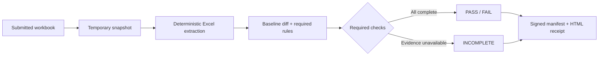

# Attestory

[](https://github.com/attestory-hq/attestory/actions/workflows/ci.yml)
[](https://pypi.org/project/attestory/)
[](LICENSE)
[](https://www.python.org/)

**Catch broken Excel formulas after an AI edit.** A forecast can still show
$412,000 after its revenue formula has been replaced with a typed number.
Attestory compares the workbook with its baseline and shows the changed cell
in a local audit receipt.

> **FAIL — `Revenue!B4`**
>
> `=SUM(B2:B3)` was replaced with hardcoded `412000`; the required formula
> check failed.

[View a sample receipt](docs/examples/sample_receipt.md) ·
[Try the Excel audit](#try-the-excel-audit)

Everything runs locally. Attestory catches formula regressions, formula
deletions, calculation errors, and rule violations. It stores content-addressed
snapshots beside the workbook and produces a signed, self-contained receipt.
Submitted workbooks are never uploaded or modified by an audit.

## Outcomes

| Outcome | Meaning |
|---|---|
| **PASS** | An existing baseline was checked; every required check completed and passed. |
| **FAIL** | A required formula, numeric, cross-file, or cell check failed. |
| **INCOMPLETE** | Required evidence was unavailable, such as a missing baseline, formula cache, or external input. |

A formula cache can be unavailable when openpyxl or LibreOffice has not supplied
a calculated value. Use `attestory commit <file.xlsx> --recalculate` when
LibreOffice is installed. Required incomplete checks block PASS.

## Try the Excel audit

Python 3.11 or newer:

```sh
python -m pip install attestory
attestory demo --dir ./attestory-demo
```

The demo creates a baseline, replaces the `Revenue!B4` formula with the value
`412000`, and runs the audit. **FAIL is the expected result**: the required
formula was replaced even though the displayed total stays the same. Open
`attestory-demo/.attestory/reports/Q4_Forecast_v2_receipt.html` to inspect the
receipt.

## Manual Excel walkthrough for contributors

Install the checkout in editable mode, then create a workspace:

```sh
python -m pip install -e .
mkdir attestory-excel-demo
cd attestory-excel-demo
```

Generate a workbook with an approved formula:

```sh
python - <<'PY'
import openpyxl

workbook = openpyxl.Workbook()
sheet = workbook.active
sheet.title = "Revenue"
sheet["B2"] = 200000
sheet["B3"] = 212000
sheet["B4"] = "=SUM(B2:B3)"
workbook.save("Q4_Forecast.xlsx")
PY
```

Capture the baseline:

```sh
attestory commit Q4_Forecast.xlsx -m "Approved formula baseline"
```

Replace the formula with a hardcoded number to simulate an AI or spreadsheet
edit:

```sh
python - <<'PY'
import openpyxl

path = "Q4_Forecast.xlsx"
workbook = openpyxl.load_workbook(path)
workbook["Revenue"]["B4"] = 412000
workbook.save(path)
PY
```

Run the audit and inspect the result:

```sh
attestory commit Q4_Forecast.xlsx -m "Edited forecast"
attestory diff Q4_Forecast.xlsx
attestory report Q4_Forecast.xlsx
```

The second commit should produce `FAIL` and identify `Revenue!B4` as a
formula-to-hardcode override. The initial baseline can be `INCOMPLETE` when
formula values or other required evidence are unavailable.

## Workflow



## Supported Excel checks

- Formula edits and formula-to-hardcode overrides
- Formula deletion and missing formula cells
- Workbook formula errors such as `#REF!`, `#DIV/0!`, `#SPILL!`, and `#CALC!`
- Missing formula caches and stale recalculated values
- Numeric assertions and single-cell named ranges
- Snapshot diffs, row/cell changes, and external-reference review
- Versioned, signed manifests and offline verification

For coverage boundaries and rule semantics, see
[Excel verification coverage](docs/EXCEL_AUDIT.md).

## Support and limitations

| Area | Supported | Boundary |
|---|---|---|
| Workbook format | `.xlsx` | Macro execution is not supported. |
| Formula values | Formula structure, cached values, and LibreOffice recalculation | Missing caches can make required checks `INCOMPLETE`; external workbook results are not recalculated. |
| Named ranges | A single-cell workbook or worksheet range | Ambiguous, dynamic, or unsupported ranges are incomplete/unsupported. |
| External references | Detection and receipt reporting | Attestory does not resolve or verify external workbook contents. |
| Other formats | PowerPoint, HTML, and CSV snapshots/diffs | Feature coverage differs from Excel; SmartArt and unstructured presentation content remain limited. |
| Local access | Workspace files, history, and receipts | Cloud synchronization and OneDrive/SharePoint conflict behavior are deployment-specific. |

## Learn more

- [Excel verification coverage](docs/EXCEL_AUDIT.md)
- [Local storage details](docs/INTEGRATIONS.md#local-storage)
- [Python API, hooks, server, and integrations](docs/INTEGRATIONS.md)
- [ChatGPT Excel edit-and-verify prototype](docs/CHATGPT_ACTION.md)
- [Claude Cowork plugin](docs/COWORK_PLUGIN.md)
- [Rule configuration](docs/INTEGRATIONS.md#rules)
- [Rules example](examples/rules.yaml)
- [Labeled regression corpus](tests/fixtures/excel_verification/cases.yaml)
- [Contributing](CONTRIBUTING.md)
- [Apache-2.0 license](LICENSE)

## Repository

- Report bugs or request Excel coverage through [GitHub Issues](https://github.com/attestory-hq/attestory/issues).
- Propose changes through [Pull Requests](https://github.com/attestory-hq/attestory/pulls).
- Current CI runs on Python 3.11 and 3.12.

Attestory is open source and processes artifacts locally. Audit history,
snapshots, and signing keys must be secured as sensitive project evidence.
