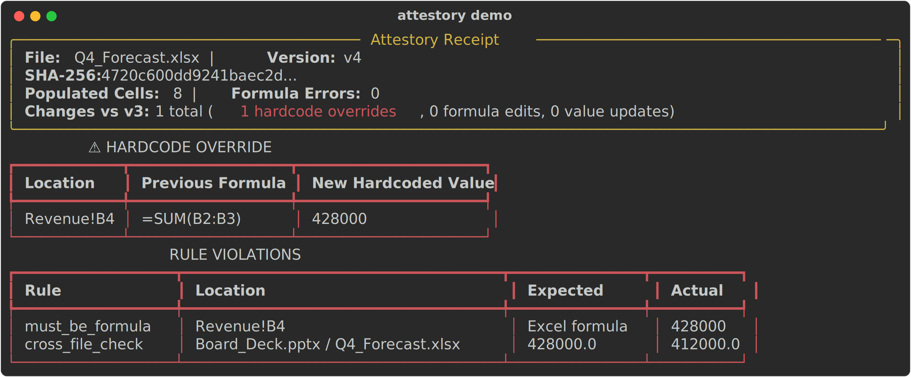
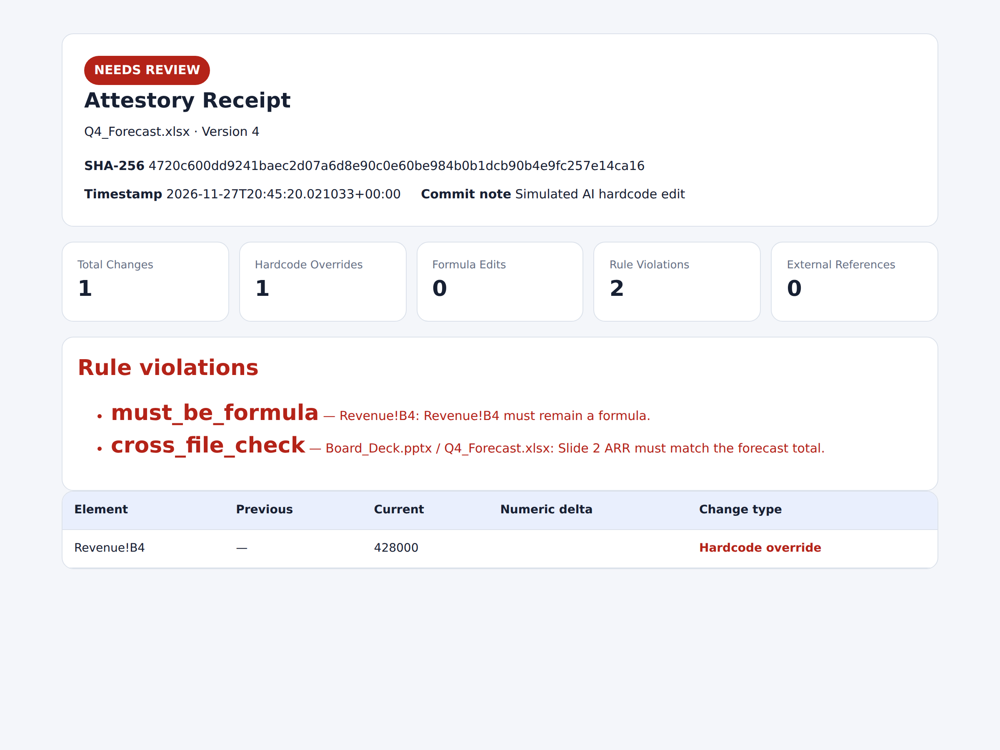

# Attestory

[](https://github.com/attestory-hq/attestory/actions/workflows/ci.yml)
[](https://pypi.org/project/attestory/)
[](https://opensource.org/licenses/Apache-2.0)
[](https://www.python.org/)

**Make sure your numbers are Attestoried.**
Local version control, deterministic formula auditing, and semantic diffs for AI-generated Excel (`.xlsx`), PowerPoint (`.pptx`), HTML dashboards, and CSV source data.

---

## Why Attestory?
AI workspaces like **Claude Cowork** and **ChatGPT** make editing spreadsheets effortless—but they also silently overwrite dynamic formulas (`=SUM(...)`) with hardcoded numbers, introduce `#REF!` errors, and create `Forecast_v7_FINAL.xlsx` chaos across email and Slack.

**Attestory** creates a lightweight, local-first `.attestory/` audit folder right alongside your spreadsheets:
- **Zero Cloud Uploads Required:** Structural snapshots are stored locally as Zstandard-compressed **Apache Parquet** files inside `.attestory/`.
- **Deterministic Math & Hardcode Audits:** Uses `openpyxl` and **DuckDB** SQL diffs to catch silent formula-to-hardcode overwrites and Excel formula errors in milliseconds.
- **PowerPoint Semantic Diffs:** Extracts slide text, native table cells, and embedded chart values into Zstandard-compressed Parquet snapshots, with DuckDB-powered comparisons between versions.
- **Dashboard & Data Lineage:** Audits HTML dashboard KPIs, table cells, and external telemetry references; fingerprints CSV row counts, schemas, null counts, and numeric summaries.
- **Persistent Assertions & Receipts:** Configure formula and numeric guardrails in `.attestory/rules.yaml`, then generate self-contained HTML audit receipts.
- **Native AI Continuity:** Install the Claude Cowork / Claude Code skill directly into your workspace with `attestory install-skill`; it reads saved rules before editing and helps catch formula mistakes before presenting results.

---

## Visual Proof

See the [sample HTML receipt](docs/examples/sample_receipt.html) in your browser.





## Quickstart

```bash
# Run the interactive demo immediately (zero setup required)
uvx attestory demo

# Install the Claude Cowork / Claude Code skill into your current workspace
attestory install-skill

# Install the Claude Code skill and automatically audit supported edits
attestory install-skill --target claude-code --hook

# Or install globally with uv / pip
uv tool install attestory
# Or: pip install attestory

# 1. Initialize .attestory/ in your working folder
attestory init

# 2. Audit and snapshot your workbook
attestory commit Q4_Forecast.xlsx -m "Initial baseline"

# 3. After editing in Excel, Claude Cowork, or ChatGPT, commit again to catch silent regressions
attestory commit Q4_Forecast.xlsx -m "Updated November actuals"

# Optionally recalculate formulas with LibreOffice before auditing
attestory commit Q4_Forecast.xlsx --recalculate

# 4. Inspect cell-level formula & value diffs
attestory diff Q4_Forecast.xlsx

# Snapshot and compare a presentation the same way
attestory commit Board_Deck.pptx -m "Initial board deck"
attestory commit Board_Deck.pptx -m "Updated ARR chart"
attestory diff Board_Deck.pptx

# Create a standalone report in .attestory/reports/
attestory report Board_Deck.pptx

# Snapshot and compare source data or an HTML dashboard
attestory commit actuals.csv -m "Approved actuals"
attestory commit executive_dashboard.html -m "Dashboard baseline"
attestory diff actuals.csv

# See the latest health of all tracked files
attestory status

# Automatically snapshot supported files when they are saved (Ctrl+C to stop)
attestory watch
```

Use `attestory watch --recursive` to include subdirectories, or tune its save
debounce with `attestory watch --debounce 1.0`.

## Python API and agent hooks

The Python API runs in-process, without starting a server or invoking the CLI:

```python
import attestory

attestory.snapshot("Q4_Forecast.xlsx", message="Approved baseline")
# After editing:
result = attestory.verify("Q4_Forecast.xlsx", message="Updated forecast")
if not result.passed:
    print(result.to_dict())
```

`snapshot` and `verify` create local snapshots. `verify` returns an
`attestory.AuditResult` with hardcode regressions, formula errors, rule
violations, and summary statistics. Its `to_dict()` shape matches the compact
JSON emitted by `attestory commit`, `diff`, `status`, and `report` with
`--json`.

For Claude Code, install the skill and opt into a project-level `PostToolUse`
hook with `attestory install-skill --target claude-code --hook`. The hook
audits `.xlsx`, `.pptx`, and `.csv` files after `Write`, `Edit`, or `MultiEdit`
tools run. It is installed only in `.claude/settings.json`, preserves existing
settings, and does not start a daemon. The `attestory` command must be
available on Claude Code's `PATH`. Claude Cowork can use the installed skill;
the project hook is specific to Claude Code.

## Rules and cross-file checks

Edit `.attestory/rules.yaml` to add deterministic assertions. Excel formula and
numeric rules are evaluated whenever the workbook is committed. Cross-file
checks run when either configured file is committed and compare the latest
snapshots available for both files:

```yaml
must_be_formula:
  - Revenue!B4
assertions:
  - location: Revenue!B4
    min_value: 100000
    description: Total ARR floor
  - location: Revenue!B5
    max_value: 250000
    description: Keep the forecast within approved bounds
cross_file_checks:
  - pptx_file: Board_Deck.pptx
    xlsx_file: Q4_Forecast.xlsx
    slide_num: 2
    element_type: chart
    label: ARR
    location: Revenue!B4
    tolerance: 0.01
    description: Slide 2 ARR chart must match the forecast
```

Numeric assertions support `min_value`, `max_value`, and `equals`. Cross-file
checks can compare any supported snapshots: Excel cells, PowerPoint slide
metrics, HTML KPIs, or CSV summary statistics. Existing `pptx_file` /
`xlsx_file` rules remain supported; generic rules use `file_a` and `file_b`
with selectors such as `metric_a: {column_name: Revenue, label: SUM}` and
`metric_b: {location: Revenue!B4}`. Rule violations appear in the terminal
receipt, commit history, and changelog.

Excel formula cells without cached results are flagged in the commit output and
HTML receipt; their values cannot be used reliably in numeric assertions.
`attestory commit <file.xlsx> --recalculate` optionally recalculates the workbook
with LibreOffice before snapshotting and evaluating assertions. LibreOffice must
be installed, and recalculation updates the workbook file. When recalculation
changes a formula's cached result, the receipt identifies it as stale.

HTML snapshots parse KPI/metric elements and table cells and flag externally
hosted scripts or tracking images for review. CSV snapshots track dataset row
counts, column types, null counts, and numeric `SUM`, `AVG`, `MIN`, and `MAX`
values, making source-data drift visible alongside workbook and presentation
changes.

## ChatGPT Actions

Install and start the local FastAPI bridge with:

```bash
pip install "attestory[server]"
attestory serve --host 127.0.0.1 --port 8765
```

The bridge provides `/health`, `/v1/context`, `/v1/commit`, `/v1/diff/{filename}`,
and `/v1/report/{filename}` as described in
[`skills/chatgpt-action/openapi.yaml`](skills/chatgpt-action/openapi.yaml).
It is scoped to the current workspace and binds to localhost by default.
Do not expose it directly to an untrusted network; ChatGPT Actions need a
separately secured HTTPS adapter or tunnel.

---

## License
Apache-2.0
